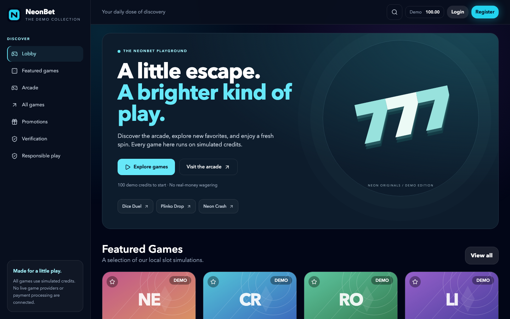
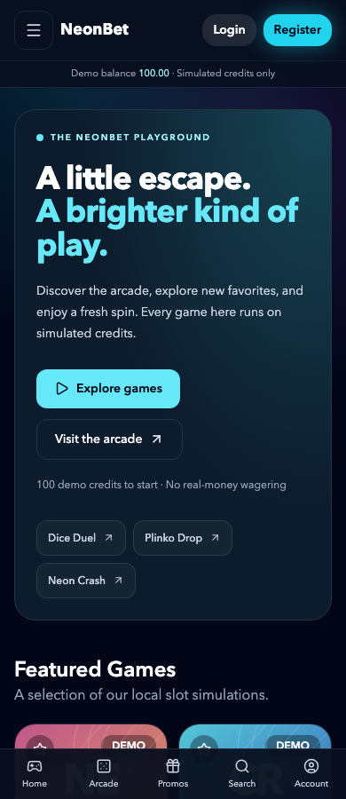

# Lucky Orbit

A mobile-first React casino **demo** with local simulated slot/arcade games, a searchable themed catalogue, and optional Supabase accounts and manual review workflows. No real payments, custody, external game sessions, or real-money wagering are enabled.

## Run locally

Use Node.js 24 or newer.

```sh
npm ci --ignore-scripts
cp .env.example .env.local
npm run dev
```

The environment template selects `demo`. Demo mode never initializes Supabase, even when credentials are present. With no explicit mode, complete credentials retain the existing automatic Supabase selection. Explicit `supabase` mode with incomplete credentials displays a configuration error rather than creating local accounts.

For optional Supabase accounts, select `VITE_APP_MODE=supabase`, set `VITE_SUPABASE_URL` and the public `VITE_SUPABASE_ANON_KEY`, and follow [database setup](docs/DATABASE.md). Never put a service-role key or provider signing credentials in a `VITE_*` variable. No live database was modified during this upgrade.

## What works

- Refined dark lobby, responsive cards, search, filters, catalogue pagination, favorites and recent games.
- Local slot simulations and Dice, Plinko and Crash games with integer-cent balances. A started round settles once even if its modal closes.
- Local demo identities and user-scoped manual records. Demo identities are browser fixtures, not secure authenticated accounts.
- Supabase sign-in, registration, session restoration, recovery form and server-authorized admin review. These are tested with mocks and isolated SQL fixtures, not a live project.
- Paginated admin data and withdrawal transitions: pending → approved/rejected; approved → paid. Marking a manual request paid does not transfer money.
- Lazy game/auth/admin/policy panels, keyboard focus handling, reduced-motion support and base-relative assets.
- Strict TypeScript for configuration resolution, account hooks, services and provider contracts; existing view components remain JSX.

## Screenshots




## Verify changes

```sh
npm run check
npm run format:check
npm run build:e2e
npx playwright install chromium webkit
npm run test:e2e
```

`check` runs lint, strict type checks, Vitest component/unit/database tests, the redacting secret scanner, a production build, and the initial-JavaScript size budget. Browser tests run the production build under `/Neonbet-Casino/` in Chromium and WebKit at 360, 390, 768 and 1440px, including axe checks, account navigation, invalid storage, forms, and failed panel downloads.

Playwright is pinned to 1.61.1 for the local macOS 14 WebKit runner. See [verification notes](docs/FULL_UPGRADE_REPORT.md) for limitations and dependency findings. GitHub validation and deployment use the same checks; the updated workflow has not been run remotely as part of this local implementation.

## Configure and extend

- `.env.example`: public mode, brand, support links and optional feature flags.
- `src/config`: brand assets, tokens, feature flags and the existing $75 manual verification configuration. Addresses remain empty.
- `src/data`: featured games, catalogue themes and promotion copy.
- `src/providers/contracts.ts`: asynchronous adapter contracts and normalized errors.
- `server/FakeProvider.ts`: local-only signed webhook/idempotency/retry harness. It is excluded from browser imports and is not a deployed payment backend.

All game titles and provider names in the catalogue are themes for local simulations. No provider affiliation or certified game mathematics is represented. The sample promotion and policy copy must be reviewed before an operational launch.

## Build and delivery

`npm run build` writes a relative-base static bundle to `dist/`. For the browser test mount, use `npm run build:e2e` and `npm run preview -- --base=/Neonbet-Casino/`.

Pushes to `main` deploy through the existing GitHub Pages workflow. This upgrade is prepared on an isolated local branch; it does not merge or deploy changes. See [deployment](docs/DEPLOYMENT.md), [architecture](docs/ARCHITECTURE.md), [upgrade report](docs/FULL_UPGRADE_REPORT.md), and [integration activation checklist](docs/INTEGRATION_ACTIVATION.md).

## Remaining product boundaries

Real provider selection, launch markets, operator arrangements, production auth/database acceptance, payment ledgers, reconciliation, custody, and live payout automation remain separate work. Simulated credits cannot become withdrawable funds. There is no self-service admin promotion or multi-tenant authorization model.

Source distribution remains subject to [LICENSE](LICENSE) and [licensing notes](docs/LICENSING.md).
